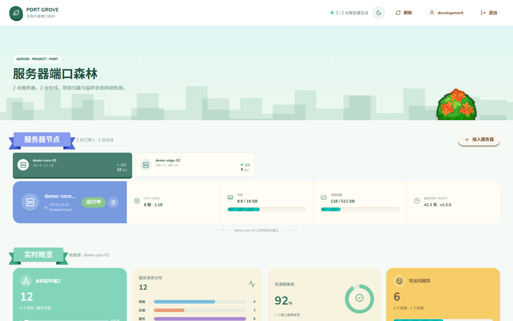
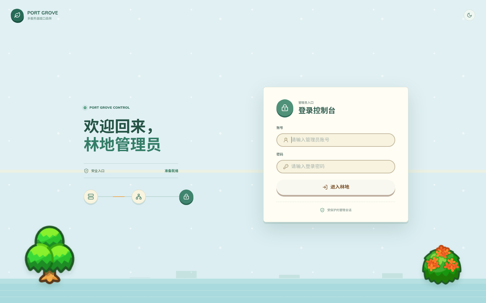

# Port Grove

[](https://github.com/QVQZZH/PortGrove/actions/workflows/ci.yml)


[](LICENSE)
[](CONTRIBUTING.md)

English | [简体中文](README.zh-CN.md)

[Features](#features) | [Quick Start](#quick-start) | [Configuration](#configuration) | [API](#api) | [Security](#security-and-limits) | [FAQ](#faq) | [Contributing](#contributing)

Port Grove is a lightweight multi-server port discovery and project health dashboard for self-hosted Linux infrastructure. A zero-dependency Python agent reports local listeners to one central React dashboard.



## Features

- Connects multiple Linux servers to one central dashboard.
- Discovers TCP listeners with `ss` and reads each PID from `/proc` only once per scan.
- Groups ports by manifests, working directories, systemd units, containers, commands, and process names.
- Detects real HTTP/HTTPS responses before showing an external-link action.
- Infers frontend, backend, database, proxy, cache, queue, monitoring, container, and system categories.
- Keeps project names and icon overrides stable across process restarts and port changes.
- Protects dashboard data and management APIs with a first-run, single-administrator account stored in SQLite.
- Sorts system services and common infrastructure before application projects.
- Removes servers immediately or asks Agent v1.3+ to disable and clean up itself.
- Stores server snapshots, port first/last-seen state, and overrides in SQLite.
- Includes responsive project cards, server switching, search, filters, and light/dark themes.
- Uses no LLM, external monitoring service, or third-party Python package.

## Use Cases

- Inventory application and infrastructure ports across a small fleet of self-hosted Linux servers.
- Find the process, systemd unit, container, or working directory behind a listener.
- Check whether an HTTP service is actually reachable before opening it.
- Keep a lightweight operational dashboard without deploying a full monitoring stack.

## Dashboard Access



There is no public registration flow. On first start, read a one-time local setup code with `scripts/manage-admin.py setup-code`, then choose the administrator username and password in the browser. The code is deleted after setup and the endpoint closes permanently. Account settings handle normal username/password changes; the CLI remains available for local recovery.

## Architecture

```text
Server A Agent ─┐
Server B Agent ─┼─ HTTPS + bearer token ─> Central API ─> SQLite ─> React dashboard
Server C Agent ─┘
```

Agents only make outbound requests. The central server can run an embedded local agent, while remote machines run `agent/agent.py` as a small systemd service.

## Quick Start

Requirements:

- Linux with `ss` from `iproute2`
- Python 3.10+
- Node.js 18+ and npm on the central server only

```bash
git clone https://github.com/QVQZZH/PortGrove.git
cd PortGrove
npm install
npm run build
PORT=2381 PUBLIC_IP=your.server.ip npm start
```

In another terminal, retrieve the one-time setup code:

```bash
python3 scripts/manage-admin.py setup-code
```

Open `http://your.server.ip:2381`, enter the setup code, and choose the administrator credentials. The central machine appears automatically because `EMBEDDED_AGENT` defaults to `1`.

## Add A Remote Server

Open the dashboard, select **Add server**, generate an enrollment command, and run the copied command on the remote server:

```bash
curl -fsSL 'https://monitor.example.com/api/agent/install.sh' | \
  sudo bash -s -- --server 'https://monitor.example.com' --token 'pg_xxx'
```

No repository clone or Node.js installation is required on the remote machine. The script downloads the matching agent from the central server, verifies the first report, binds the enrollment token to that server, and starts systemd. The central server derives the public address from the report connection when `PUBLIC_IP` is not supplied.

Use HTTPS outside a trusted private network. Commands generated from an HTTP dashboard include `--insecure` for temporary testing.

## Production systemd Setup

```bash
sudo mkdir -p /opt/port-grove
sudo rsync -a ./ /opt/port-grove/
cd /opt/port-grove
npm install
npm run build
sudo install -d -m 700 /var/lib/port-grove
sudo cp deploy/port-grove.env.example /etc/port-grove.env
sudo chmod 600 /etc/port-grove.env
sudo cp docs/systemd/port-grove.service /etc/systemd/system/
sudo systemctl daemon-reload
sudo systemctl enable --now port-grove
sudo python3 scripts/manage-admin.py setup-code
```

Enrollment tokens are generated in the dashboard, stored as hashes, and bound to the first server that uses them.

## Configuration

| Variable | Component | Default | Description |
| --- | --- | --- | --- |
| `PORT` | Central | `2381` | Dashboard and API port. |
| `AGENT_TOKEN` | Both | unset | Optional legacy shared token; dashboard enrollment tokens are preferred. |
| `EMBEDDED_AGENT` | Central | `1` | Probe the central machine locally. |
| `DATABASE_PATH` | Central | `server/port_grove.db` | SQLite database path. |
| `SETUP_TOKEN_PATH` | Central | Next to the database | Local one-time setup-code file. |
| `PORT_GROVE_SERVER` | Agent | `http://127.0.0.1:2381` | Central server URL. |
| `PROBE_INTERVAL` | Both | `30` | Probe/report interval in seconds. |
| `SERVER_ID` | Agent | machine-derived | Stable explicit server identity. |
| `PUBLIC_IP` | Agent | empty | Address used for verified Web links. |
| `SERVER_NAME` | Agent | hostname | Dashboard display name. |
| `SERVER_PROVIDER` | Agent | `Self-hosted` | Provider/location label. |
| `TRUST_PROXY` | Central | `0` | Trust `X-Forwarded-For` when deriving an agent address. |
| `SESSION_TTL` | Central | `43200` | Login session lifetime in seconds. |
| `AUTH_DISABLED` | Central | `0` | Disable login for local development only. |

## API

```http
GET /api/status?server={serverId}
GET /api/servers
GET /api/auth/status
POST /api/auth/setup
POST /api/auth/login
POST /api/auth/logout
POST /api/auth/account
GET /api/enrollment-tokens
POST /api/enrollment-tokens
POST /api/agent/report
Authorization: Bearer <enrollmentToken>
POST /api/servers/{serverId}/remove
POST /api/servers/{serverId}/projects/{projectId}/rename
```

Project updates accept `name`, `owner`, `description`, and one of the built-in icon IDs. Agent reports use schema version `1` and are limited to 2 MiB.

## Accuracy And Resource Use

The agent performs one `ss -ltnpH` command per cycle, caches `/proc` reads by PID, and uses short local TCP/HTTP probes. A typical small server scan completes in well under one second. Classification records its evidence and confidence; unresolved services use a default icon instead of an invented project identity.

The central receipt time determines online/offline status, so clock skew on remote servers does not create false offline states.

## Security And Limits

- Enrollment tokens are only returned once, stored as SHA-256 hashes, and bound to the first reporting server ID. Use HTTPS because bearer tokens are not protected on plain HTTP.
- Dashboard passwords use PBKDF2-SHA256 in SQLite; sessions use signed HttpOnly, SameSite cookies and login attempt throttling. First-run setup requires a local, one-time code. Account changes and CLI recovery invalidate every previous session.
- Agent decommission is delivered through the next outbound report. Offline nodes stay in a removing state until they reconnect; older agents must be upgraded or removed from the dashboard only.
- Linux and TCP listeners only; UDP is not scanned.
- Root gives the agent the most accurate cross-user `/proc` data. An unprivileged agent still works with reduced process metadata.
- Direct Web links require a public bind address and a verified HTTP/HTTPS response. `PUBLIC_IP` can be configured explicitly or derived from the report connection.
- Animal Island UI uses CC BY-NC 4.0; review that upstream license before commercial use.

## Roadmap

- Enrollment token management and rotation controls.
- Port history and change-event views.
- Docker Compose and PM2 metadata enrichment.
- Optional webhook notifications.
- PostgreSQL and Kubernetes support for larger installations.

## FAQ

**Does Port Grove expose every listening port as a link?**

No. A link appears only after the agent receives a valid HTTP or HTTPS response and has a usable public address.

**Can the agent run without root?**

Yes, but Linux may hide process metadata owned by other users. Running the agent as root provides the most complete inventory.

**Is it intended for public, unauthenticated dashboards?**

No. Authentication is enabled by default. Use HTTPS and keep `AUTH_DISABLED=0` outside local development.

## Contributing

Bug reports and focused pull requests are welcome. Read [CONTRIBUTING.md](CONTRIBUTING.md) before submitting changes. Report security issues through the process in [SECURITY.md](SECURITY.md), not through a public issue.

## License

Port Grove source code is released under the [MIT License](LICENSE). The interface depends on Animal Island UI, which is licensed under CC BY-NC 4.0 and restricts commercial use. See [THIRD_PARTY_NOTICES.md](THIRD_PARTY_NOTICES.md) before distributing a built interface.
