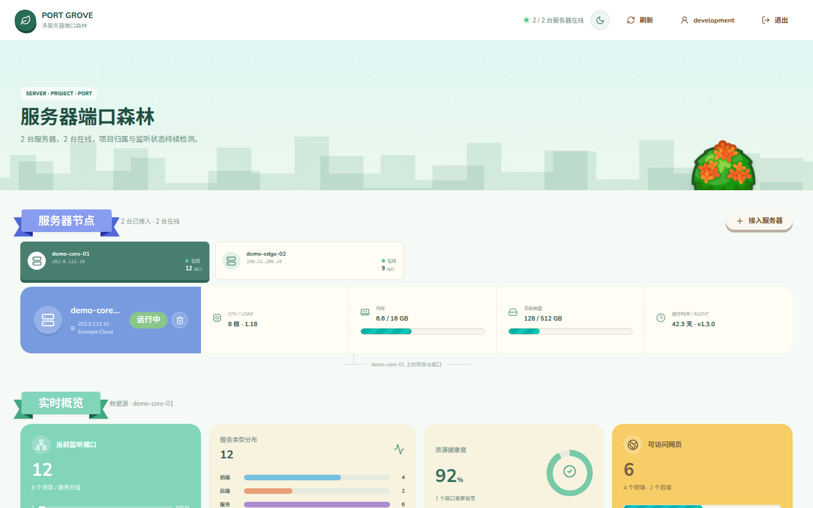
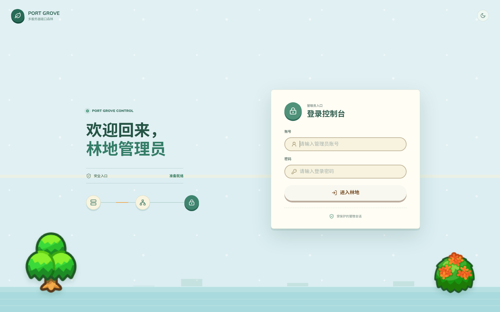

# Port Grove 项目端口森林

[](https://github.com/QVQZZH/PortGrove/actions/workflows/ci.yml)


[](LICENSE)
[](CONTRIBUTING.md)

[English](README.md) | 简体中文

[功能](#功能) | [快速开始](#快速开始) | [配置](#配置) | [API](#api) | [安全与限制](#安全与限制) | [常见问题](#常见问题) | [参与贡献](#参与贡献)

Port Grove 是一个面向自托管 Linux 服务器的轻量级多服务器端口发现与项目健康面板。每台服务器运行一个零第三方 Python 依赖的 Agent，统一向中央 React 面板上报。



## 功能

- 一个中央面板管理多台 Linux 服务器。
- 通过 `ss` 发现 TCP 监听端口，每轮扫描中每个 PID 只读取一次 `/proc`。
- 根据项目清单、工作目录、systemd、容器、启动命令和进程名归类项目。
- 实际确认 HTTP/HTTPS 响应后才显示网页跳转按钮。
- 自动识别前端、后端、数据库、代理、缓存、队列、监控、容器和系统服务图标。
- 项目名称与图标修改按“服务器 + 项目指纹”保存，不受 PID 或端口变化影响。
- 使用 SQLite 单管理员账号保护面板数据和管理 API，首次启动通过本机一次性码初始化。
- 系统服务和常见基础设施默认排在应用项目之前。
- 支持直接删除记录，或通知 Agent v1.3+ 禁用并清理自身。
- 使用 SQLite 保存服务器快照、端口首次/最后出现时间和项目覆盖规则。
- 支持服务器切换、项目卡片、搜索过滤、响应式布局和明暗主题。
- 不使用 LLM、外部监控平台或第三方 Python 包。

## 使用场景

- 统一盘点小规模自托管 Linux 服务器上的应用与基础设施端口。
- 定位监听端口背后的进程、systemd 单元、容器或工作目录。
- 在打开网页入口前，确认对应 HTTP 服务确实可访问。
- 不部署完整监控平台，也能获得轻量的运维视图。

## 面板登录



项目不存在公开注册流程。首次启动后，在主面板服务器本机运行 `scripts/manage-admin.py setup-code` 获取一次性初始化码，再在浏览器中自定义管理员账号密码。完成后初始化码会被删除，初始化接口永久关闭。日常修改账号密码使用网页“账户设置”，忘记密码时才需要本机 CLI 恢复。

## 架构

```text
服务器 A Agent ─┐
服务器 B Agent ─┼─ HTTPS + Token ─> 中央 API ─> SQLite ─> React 面板
服务器 C Agent ─┘
```

Agent 只发起出站请求。中央服务器可以启用内置本机探针，其他服务器使用 `agent/agent.py` 作为轻量 systemd 服务。

## 快速开始

要求：Linux、Python 3.10+、`iproute2`；只有中央服务器需要 Node.js 18+ 和 npm。

```bash
git clone https://github.com/QVQZZH/PortGrove.git
cd PortGrove
npm install
npm run build
PORT=2381 PUBLIC_IP=你的服务器IP npm start
```

在另一个终端读取一次性初始化码：

```bash
python3 scripts/manage-admin.py setup-code
```

访问 `http://你的服务器IP:2381`，输入初始化码并自定义管理员账号密码。`EMBEDDED_AGENT` 默认为 `1`，中央服务器会自动出现在面板中。

## 添加远程服务器

在主面板点击“接入服务器”，生成接入令牌并复制命令，然后在远程服务器执行：

```bash
curl -fsSL 'https://monitor.example.com/api/agent/install.sh' | \
  sudo bash -s -- --server 'https://monitor.example.com' --token 'pg_xxx'
```

远程服务器不需要克隆仓库，也不需要安装 Node.js。脚本会从主面板下载匹配版本的 Agent，完成首次真实上报、令牌绑定并启动 systemd。未配置 `PUBLIC_IP` 时，中央端会从上报连接自动识别服务器地址。

跨公网应使用 HTTPS。通过 HTTP 面板生成的测试命令会自动包含 `--insecure`。

## 中央端 systemd 部署

```bash
sudo mkdir -p /opt/port-grove
sudo rsync -a ./ /opt/port-grove/
cd /opt/port-grove
npm install
npm run build
sudo install -d -m 700 /var/lib/port-grove
sudo cp deploy/port-grove.env.example /etc/port-grove.env
sudo chmod 600 /etc/port-grove.env
sudo cp docs/systemd/port-grove.service /etc/systemd/system/
sudo systemctl daemon-reload
sudo systemctl enable --now port-grove
sudo python3 scripts/manage-admin.py setup-code
```

接入令牌由主面板生成，只保存哈希，并在首次上报后绑定到对应服务器。

## 配置

| 变量 | 组件 | 默认值 | 说明 |
| --- | --- | --- | --- |
| `PORT` | 中央端 | `2381` | 面板和 API 端口。 |
| `AGENT_TOKEN` | 两端 | 未设置 | 可选的旧版共享 Token；推荐使用面板接入令牌。 |
| `EMBEDDED_AGENT` | 中央端 | `1` | 是否探测中央服务器本机。 |
| `DATABASE_PATH` | 中央端 | `server/port_grove.db` | SQLite 数据库路径。 |
| `SETUP_TOKEN_PATH` | 中央端 | 与数据库同目录 | 本机一次性初始化码文件。 |
| `PORT_GROVE_SERVER` | Agent | `http://127.0.0.1:2381` | 中央端地址。 |
| `PROBE_INTERVAL` | 两端 | `30` | 探测/上报间隔，单位秒。 |
| `SERVER_ID` | Agent | 根据机器生成 | 可显式设置的稳定服务器身份。 |
| `PUBLIC_IP` | Agent | 空 | 生成已验证网页入口使用的地址。 |
| `SERVER_NAME` | Agent | 主机名 | 页面显示名称。 |
| `SERVER_PROVIDER` | Agent | `Self-hosted` | 服务商或位置标签。 |
| `TRUST_PROXY` | 中央端 | `0` | 是否信任 `X-Forwarded-For` 获取 Agent 地址。 |
| `SESSION_TTL` | 中央端 | `43200` | 登录会话有效秒数。 |
| `AUTH_DISABLED` | 中央端 | `0` | 仅在本机开发时关闭登录。 |

## API

```http
GET /api/status?server={serverId}
GET /api/servers
GET /api/auth/status
POST /api/auth/setup
POST /api/auth/login
POST /api/auth/logout
POST /api/auth/account
GET /api/enrollment-tokens
POST /api/enrollment-tokens
POST /api/agent/report
Authorization: Bearer <接入令牌>
POST /api/servers/{serverId}/remove
POST /api/servers/{serverId}/projects/{projectId}/rename
```

项目修改支持 `name`、`owner`、`description` 和内置图标 ID。Agent 使用版本 `1` 的上报格式，单次请求最大 2 MiB。

## 准确性与资源占用

Agent 每轮只执行一次 `ss -ltnpH`，按 PID 缓存 `/proc` 数据，并使用短超时进行本机 TCP/HTTP 探测。一般小型服务器单轮采集远低于一秒。分类会保存判断来源和置信度；无法分辨的服务使用默认图标，不会凭空生成项目归属。

在线状态以中央端实际收到报告的时间为准，不会因为远程服务器时钟偏差误判离线。

## 安全与限制

- 接入令牌只返回一次，中央端仅保存 SHA-256 哈希，首次上报后绑定对应服务器 ID。跨公网必须使用 HTTPS。
- 管理员密码使用 PBKDF2-SHA256 哈希保存在 SQLite；会话使用签名的 HttpOnly、SameSite Cookie，并限制登录失败频率。首次初始化需要服务器本机一次性码，网页改密或 CLI 恢复都会使旧会话失效。
- 远程解绑指令通过 Agent 下一次出站上报下发。离线节点会保持“解绑中”，旧 Agent 需要先升级或仅从面板删除。
- 目前只支持 Linux TCP 监听端口，不扫描 UDP。
- root 运行 Agent 时跨用户进程信息最完整；普通用户也能运行，但部分进程归属会缺失。
- 网页入口要求端口公网绑定且探针确实收到 HTTP/HTTPS 响应；地址可以显式配置，也可以从上报连接自动识别。
- Animal Island UI 使用 CC BY-NC 4.0，商业使用前需要检查该依赖许可证。

## 路线图

- 接入令牌管理与轮换操作。
- 端口历史和变更事件页面。
- Docker Compose、PM2 元数据增强。
- 可选 Webhook 告警。
- 面向更大规模部署的 PostgreSQL 和 Kubernetes 支持。

## 常见问题

**Port Grove 会把所有监听端口都显示为网页链接吗？**

不会。只有 Agent 确认收到有效 HTTP 或 HTTPS 响应，并且服务器存在可用公开地址时，界面才会显示链接。

**Agent 可以不使用 root 运行吗？**

可以，但 Linux 可能隐藏其他用户拥有的进程元数据。使用 root 运行时，端口归属信息最完整。

**适合部署成无需登录的公开面板吗？**

不适合。认证默认开启；在本机开发之外应使用 HTTPS，并保持 `AUTH_DISABLED=0`。

## 参与贡献

欢迎提交问题报告和范围明确的 Pull Request。提交改动前请阅读 [CONTRIBUTING.md](CONTRIBUTING.md)。安全问题请按 [SECURITY.md](SECURITY.md) 私下报告，不要创建公开 Issue。

## 许可证

Port Grove 源代码使用 [MIT License](LICENSE)。界面依赖的 Animal Island UI 使用 CC BY-NC 4.0，并限制商业用途。分发构建后的界面前请阅读 [THIRD_PARTY_NOTICES.md](THIRD_PARTY_NOTICES.md)。
